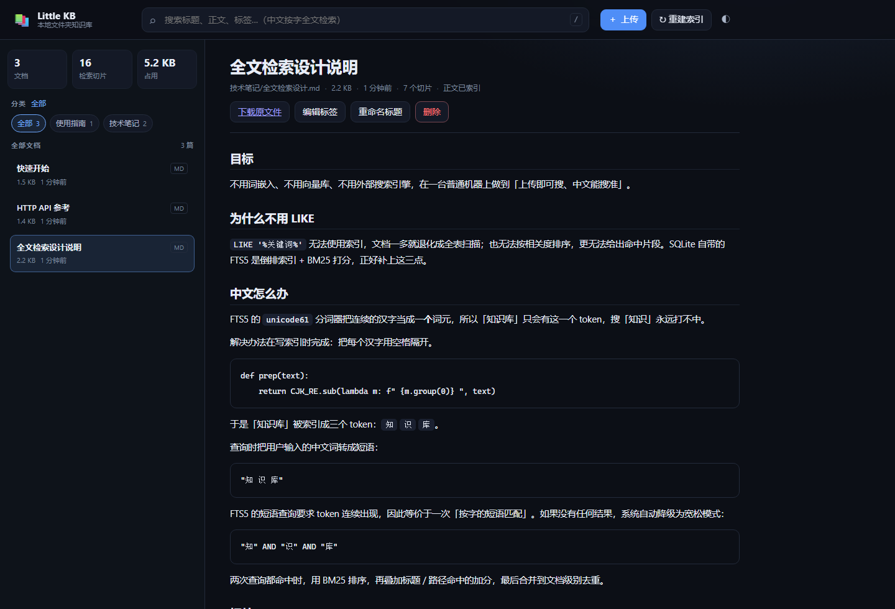
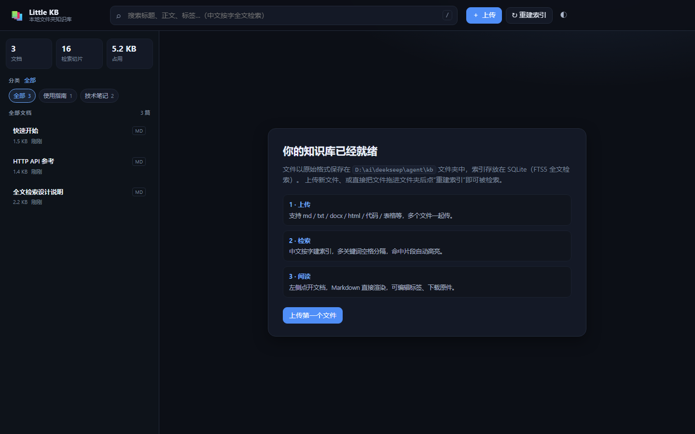
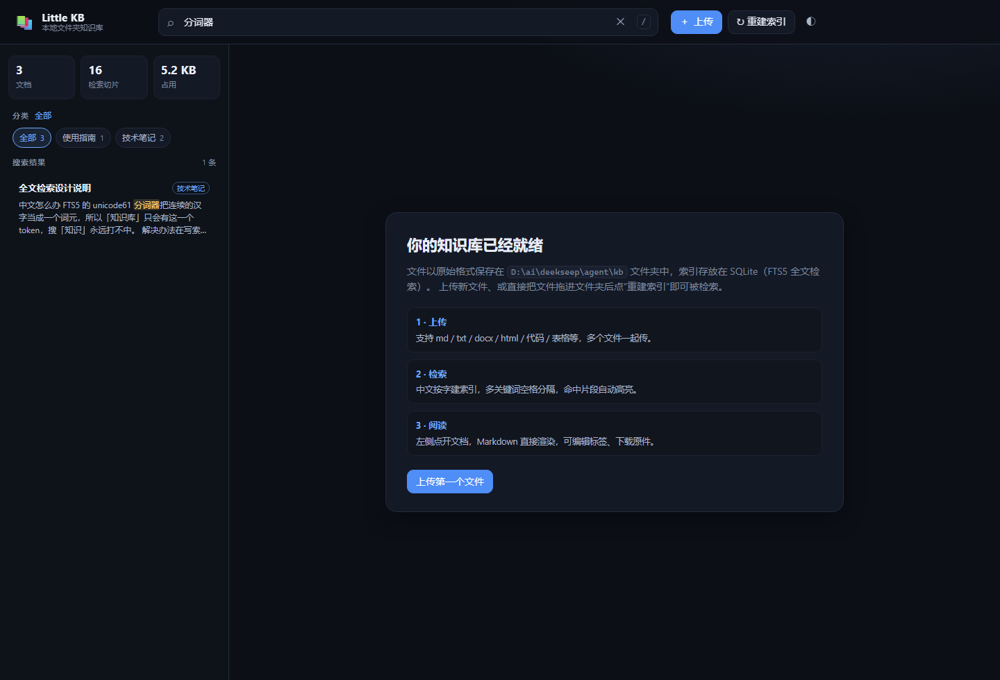
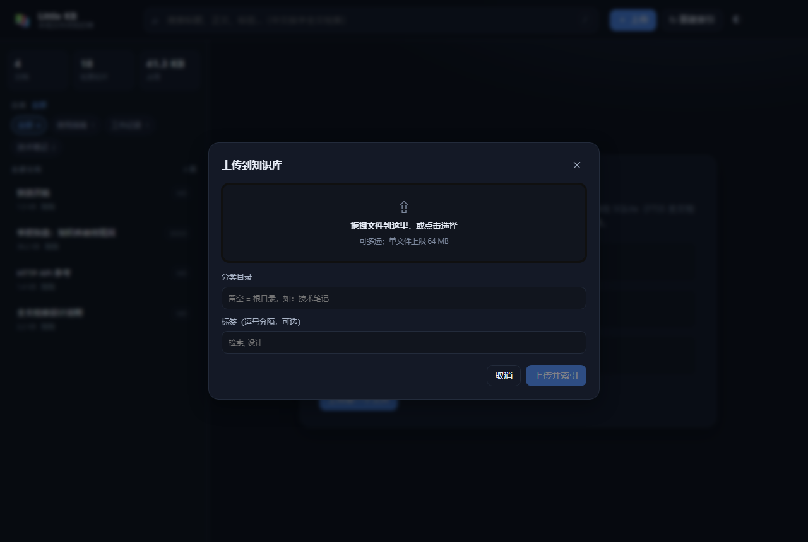
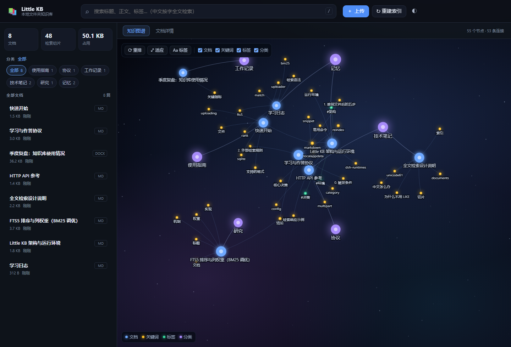

# Little KB · 本地文件夹知识库

> 仓库：<https://github.com/xiaoyiyi-sun/WRJ_mod>

一个**零第三方依赖**的个人知识库：文件以原始格式躺在 `kb/` 文件夹里，SQLite FTS5 负责全文检索，自带一个深色主题的 Web 界面。没有词嵌入、没有向量库、不需要安装任何包。



```
知识库文件夹 (kb/)  ──扫描──▶  切片 + 中文预处理  ──▶  SQLite（元数据 + FTS5 倒排索引）
        ▲                                                     │
        └────────── 上传 / 删除 / 下载 ◀── Web API ◀── 检索 + 高亮片段 ──▶ 浏览器界面
```

## 快速开始

```bat
run.cmd
```

然后打开 <http://127.0.0.1:8777>（端口被占用会自动顺延，控制台会打印实际地址）。

也可以用 PowerShell：

```powershell
.\run.ps1 --port 9000
```

首次启动会自动扫描 `kb/`，把已有文件全部建立索引。

## 在别的电脑上运行

只有两个要求：**Python 3.8+**（标准库自带 SQLite FTS5），**不需要 pip install 任何东西**。

```bash
git clone https://github.com/xiaoyiyi-sun/WRJ_mod.git
cd WRJ_mod
```

Windows 双击 `run.cmd`；macOS / Linux：

```bash
python3 server.py
```

浏览器打开 <http://127.0.0.1:8777> 即可。首次启动会自动创建 `data/`、扫描 `kb/` 并建索引（约 5 秒，83 篇文档）。

说明：

- 脚本会依次尝试 `.venv` → 环境变量 `LITTLE_KB_PYTHON` → `py -3` / `python`，都没有才会报错；
- 端口被占用会自动顺延，控制台会打印实际地址；
- `data/` 和 `out/` 是运行时产物，不随仓库分发，删掉后重启会自动重建。

## 目录结构

```
kbcore/
  config.py     路径与常量
  textutil.py   中文预处理、查询解析、片段高亮
  extract.py    文本提取（md/docx/html/代码/二进制兜底）与切片
  index.py      SQLite schema、写入、BM25 检索、统计
  library.py    文件夹读写、上传、扫描、删除、展示数据
  keywords.py   关键词抽取（字级 n-gram + 左右熵，无词典）
  graph.py      知识图谱节点/连线构建与缓存
server.py       HTTP 服务（静态资源 + JSON API，标准库实现）
web/            index.html / style.css / app.js / graph.js（原生 JS，无构建）
scripts/
  kb.py         命令行：写笔记 / 检索 / 统计（给 Agent 用，不依赖服务）
  smoke_test.py 端到端冒烟测试（上传 → 检索 → 改标签 → 删除 → 重建索引）
  setup_env.ps1 一键安装 Node.js LTS + MinGit + pnpm（用户级，免管理员）
docs/           界面截图
kb/             你的知识库：文件原样存放在这里，子文件夹即分类
data/           kb.sqlite3（索引，可随时删除重建）、kb.port
```

## 界面

| 首页 | 检索 | 阅读 | 上传 |
| --- | --- | --- | --- |
|  |  |  |  |

支持深链：`/?q=关键词` 直接带搜索词打开，`/?upload=1` 直接打开上传框，`/#doc-12` 直接打开某篇文档。

## 功能

- **上传**：拖拽或多选文件，可选分类目录与标签，上传后立即建索引。
- **检索**：中文按字短语匹配，英文前缀匹配，多关键词 AND；标题 / 路径 / 标签额外加分；命中片段自动高亮。
- **知识图谱**：分类 / 文档 / 标签 / 关键词四类节点，力导向布局 + 深空视觉，可拖拽、缩放、按类型筛选；搜索时命中的文档会在图里高亮。滚轮缩放、拖动平移、点击文档节点直接打开、点击关键词节点直接搜它。
- **浏览**：左侧按分类分组的文档列表，右侧 Markdown 渲染（标题、列表、代码块、引用、表格、链接）。
- **维护**：重建索引（按 SHA-256 + mtime 跳过未变化文件）、改标题、改标签、下载原件、删除。

## 知识图谱 · 中枢



节点四类：**分类**（紫）、**文档**（蓝，大小按字数）、**关键词**（黄）、**标签**（绿）。
连线：分类→文档、文档→关键词、文档→标签。

关键词不是随便切的：先用字级 n-gram 统计候选，再用**左右熵**判断它像不像一个词——
「件夹」「识库」这类跨词边界的碎片，一侧邻字几乎固定、熵接近 0，会被直接淘汰；
标题（Markdown heading）是作者亲手写的概念，优先入选。

交互：滚轮缩放、拖动平移、拖节点调整、悬停看详情、点文档节点打开正文、点关键词节点直接搜它、勾选类型过滤、`重排` 打散重跑布局、`适应` 回到全览。

## 作为 Agent 的长期记忆

这个库同时是「我的记忆」：写笔记不需要开 Web 服务。

```bash
# 写入一条记忆（同名文件会自动追加「补充」小节，不会产生重复文件）
python scripts/kb.py note "SQLite FTS5 中文索引" "把汉字逐个插空格再建索引，查询时用单字短语。" --category 记忆 --tags 检索,sqlite

# 消化一篇长文：先看骨架，再读正文
python scripts/kb.py digest 3 --preview 160
python scripts/kb.py show 3 --chars 4000

# 记一行学习日志（自动建索引）
python scripts/kb.py log "FTS5 列权重" "标题命中会被长文档稀释，用 bm25(t,10,1) 纠正。" --source "SQLite 官方文档"

# 检索自己的记忆
python scripts/kb.py search "中文 索引" --limit 5

# 概况
python scripts/kb.py stats
```

HTTP 侧等价接口：`POST /api/note`，`{"title":"…","content":"…","category":"记忆","tags":"…"}`。
写进去的内容会立刻出现在左侧列表、检索结果和知识图谱里。

## 学习管线：收文件 → 消化 → 沉淀

规则写死在知识库里：[学习与作答协议](kb/协议/学习与作答协议.md)。它约束我每次怎么处理你给的材料、怎么找外部资料、答案按什么结构组织。要点：

**收到的文件，五步走**

| 步骤 | 动作 | 命令 |
| --- | --- | --- |
| 1 入库 | 落到 `kb/<分类>/` 并建索引 | 上传 / `POST /api/reindex` |
| 2 摸结构 | 看标题树、切片、关键词、代码块统计 | `python scripts\kb.py digest <id>` |
| 3 精读 | 按切片读正文 | `python scripts\kb.py show <id> --chars 4000` |
| 4 验证 | 关键结论找第二来源，冲突写进「分歧」 | 检索 + 实测 |
| 5 沉淀 | 写笔记、回链原文、记日志 | `kb.py note` + `kb.py log` |

**自己找资料时的规矩**

- 来源分级：A 官方文档/源码/规范，B 工程博客/教材，C 论坛二手转述；C 只当线索。
- 事实性结论至少两个独立来源；只有一个就标注「单一来源，待验证」。
- 涉及版本/API 的写明版本号与访问日期；代码能跑就跑，跑不了标「未验证」。
- 明确区分「文档如此说」与「我实测如此」。

**答案的固定结构**：结论先行 → 机制 → 实现 → 代价与失败模式 → 怎么验证 → 参考。没跑过的只写「设计」，不写「实现」。

已按这套流程跑过一个样例：[FTS5 排序与列权重](kb/研究/FTS5 排序与列权重.md)，以及累积的 [学习日志](kb/记忆/学习日志.md)。

## 无人机知识体系

`kb/无人机/知识库/` 下有 24 个专题页，覆盖「设计一台新机」和「调好一台现机」的闭环，并向固定翼、混动、集群、适航延伸：

| 主题 | 页面 |
| --- | --- |
| 整机设计 | [设计流程与校核](kb/无人机/知识库/设计流程与校核.md)、[动力系统匹配](kb/无人机/知识库/动力系统匹配.md)、[结构设计与共振](kb/无人机/知识库/结构设计与共振.md)、[电池与电源系统](kb/无人机/知识库/电池与电源系统.md)、[作业载荷与光伏清洗](kb/无人机/知识库/作业载荷与光伏清洗.md) |
| 构型扩展 | [固定翼与 VTOL](kb/无人机/知识库/固定翼与VTOL.md)、[油动与混动系统](kb/无人机/知识库/油动与混动系统.md)、[集群与编队](kb/无人机/知识库/集群与编队.md) |
| 控制调参 | [姿态控制原理](kb/无人机/知识库/姿态控制原理.md)、[姿态振荡诊断与调参](kb/无人机/知识库/姿态振荡诊断与调参.md)、[位置控制与定高](kb/无人机/知识库/位置控制与定高.md)、[振动滤波与陷波](kb/无人机/知识库/振动滤波与陷波.md) |
| 导航与安全 | [EKF 与导航融合](kb/无人机/知识库/EKF与导航融合.md)、[传感器与标定](kb/无人机/知识库/传感器与标定.md)、[飞行模式与失效保护](kb/无人机/知识库/飞行模式与失效保护.md)、[通信链路与地面站](kb/无人机/知识库/通信链路与地面站.md) |
| 运维与合规 | [故障诊断手册](kb/无人机/知识库/故障诊断手册.md)、[故障案例库](kb/无人机/知识库/故障案例库.md)、[日志判读速查](kb/无人机/知识库/日志判读速查.md)、[适航与型号审定](kb/无人机/知识库/适航与型号审定.md)、[法规与空域要点](kb/无人机/知识库/法规与空域要点.md) |
| 生态与参数 | [飞控生态对比](kb/无人机/知识库/飞控生态对比.md)、[参数体系与命名迁移](kb/无人机/知识库/参数体系与命名迁移.md)、[知识库自检](kb/无人机/知识库/知识库自检.md)、[导航](kb/无人机/知识库/00-知识库导航.md) + 1127 条语义库 |

参数工具：

```bat
python scripts\kb.py paramdoc ATC_RAT_RLL_D      :: 查语义
python scripts\kb.py paramdoc --category 姿态控制 :: 按系统列参数
python scripts\kb.py param MOT_THST_HOVER        :: 查两台机的值（仅参考）
python scripts\kb.py param-diff 四轴 六轴         :: 两机差异
python scripts\build_paramdict.py                :: 重建语义库
python scripts\verify_params.py                  :: 校验解析忠实度
```

## 中文检索是怎么做的

`unicode61` 分词器会把连续汉字当成一个词元（「知识库」= 1 个 token），导致「知识」搜不到。解决方式：

1. 写索引前把每个汉字空格隔开：`知识库` → `知 识 库`；
2. 查询时把中文词转成 FTS5 短语 `"知 识 库"`，要求 token 连续；
3. 无结果时自动降级为按字 AND，保证召回；
4. 用 BM25 排序，再叠加元数据命中加分，按文档去重后返回片段。

细节见 `kb/技术笔记/全文检索设计.md`。

## API

| 方法 | 路径 | 说明 |
| --- | --- | --- |
| GET | `/api/health` | 健康检查 |
| GET | `/api/config` | 知识库路径等配置 |
| GET | `/api/stats` | 文档数 / 切片数 / 占用 / 分类统计 |
| GET | `/api/tree` | 分类树与文档列表 |
| GET | `/api/search?q=&limit=&category=` | 全文检索 |
| GET | `/api/graph?docs=&terms=` | 知识图谱节点与连线 |
| GET | `/api/doc/{id}` | 文档详情 |
| GET | `/api/doc/{id}/raw` | 原始文件下载 |
| POST | `/api/upload` | multipart 上传（`files` / `category` / `tags`） |
| POST | `/api/note` | 写入一条记忆（`title` / `content` / `category` / `tags`） |
| POST | `/api/reindex` | 重建索引 |
| PATCH | `/api/doc/{id}` | 修改 title / tags |
| DELETE | `/api/doc/{id}` | 删除文档与文件 |

## 验证

```bat
python scripts\smoke_test.py http://127.0.0.1:8777
```

覆盖 12 项检查：中文文件名上传、分类落盘、中文唯一词检索、片段高亮、英文前缀、标签命中、标签修改、详情正文、切片数、重建索引、删除、删除后不再命中。

## 后续加词嵌入的落点

- 新增 `chunks_vec` 表（chunk_id, 向量, 模型名），写入时在同一事务里生成。
- `Index.search()` 里把 BM25 结果与向量 top-k 做加权融合（RRF 或归一化加权）。
- 前端不需要改：接口保持 `{hits: [...]}` 结构，只多一个 `mode: "hybrid"`。
- 不引入第三方库也能做：调用任意 embedding HTTP 接口即可，注意加本地缓存表避免重复计费。

## 运行环境

本项目本身零依赖，只要有 **Python 3.8+** 就能跑。下面是参考开发机的环境，仅作记录，不是运行要求：

| 组件 | 版本 | 位置 | 说明 |
| --- | --- | --- | --- |
| Python | 3.12.14 | `%USERPROFILE%\.dsh\dsh-runtimes\...\python\python.exe` | 服务端与索引脚本，SQLite 3.53 自带 FTS5 |
| Node.js | v26.13.0 | `%LOCALAPPDATA%\Programs\node` | 含 npm 11.20 |
| pnpm | 12.16.1 | 同上（npm 全局） | 需要时用它装前端依赖 |
| Git | 2.56.0.windows.4 | `%LOCALAPPDATA%\Programs\git\cmd` | MinGit，含 `git` 命令 |
| SQLite FTS5 | 3.53.1 | Python 内置 | 全文检索引擎 |

路径已写入**用户级 PATH**，新开的终端直接可用：

```powershell
node -v; npm -v; pnpm -v; git --version
```

重装/补装只需再跑一次（幂等，已存在的会跳过）：

```powershell
powershell -NoProfile -ExecutionPolicy Bypass -File .\scripts\setup_env.ps1
```

脚本走国内镜像（npmmirror / 清华 TUNA），避免 GitHub 直连超时。PowerShell 执行策略已设为 `RemoteSigned`（仅当前用户），否则 `npm`/`pnpm` 的 `.ps1` 包装脚本会被拦截。

## 说明

- 服务默认只监听 `127.0.0.1`；如需局域网访问，用 `--host 0.0.0.0` 并自行加访问控制。
- 单文件上传上限 64 MB（`kbcore/config.py` 可改）。
- 索引是派生数据：删除 `data/kb.sqlite3` 后重启即可重建，不会影响 `kb/` 中的原始文件。
- 机器上没有 `python` 命令时，`run.cmd` / `run.ps1` 会依次尝试 `.venv`、`LITTLE_KB_PYTHON` 环境变量、`py -3`；仍有问题就用 `python3 server.py` 直接启动。
